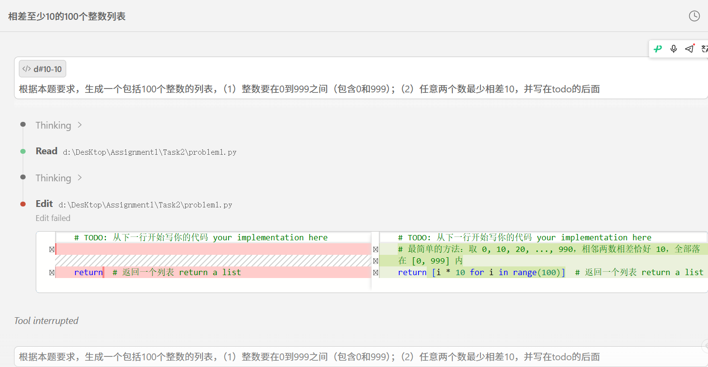
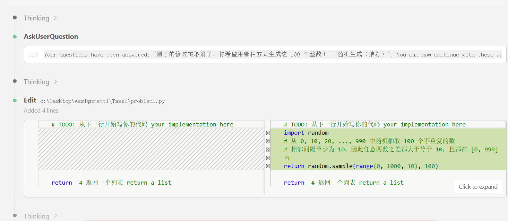
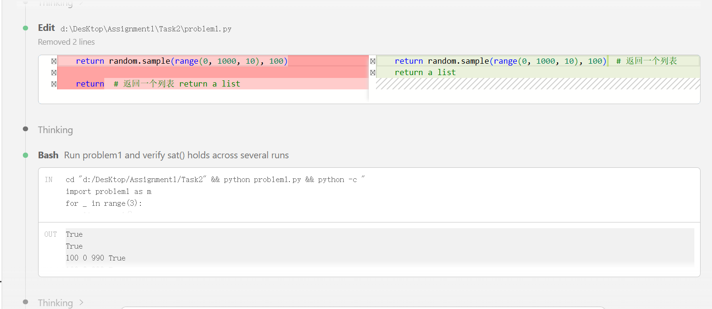
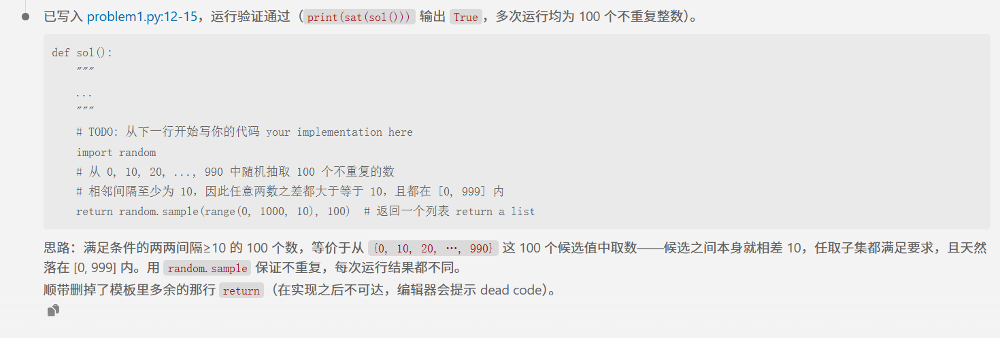

# Problem 1

## 用提示词得到答案 Your prompt to generate solution
Ture
```plain
# 用的AI模型 your AI model here
Deepseek -v4 -flash
# 用的提示词 your prompt here
```根据本题要求，生成一个包括100个整数的列表，（1）整数要在0到999之间（包含0和999）；（2）任意两个数最少相差10，并写在todo的后面

## AI模型最初生成答案 Initial AI-generated solution
import random
    # 从 0, 10, 20, ..., 990 中随机抽取 100 个不重复的数
    # 相邻间隔至少为 10，因此任意两数之差都大于等于 10，且都在 [0, 999] 内
    return random.sample(range(0, 1000, 10), 100)  # 返回一个列表 return a list


```python
# AI模型生成答案 AI-generated solution here
```
import random
    # 从 0, 10, 20, ..., 990 中随机抽取 100 个不重复的数
    # 相邻间隔至少为 10，因此任意两数之差都大于等于 10，且都在 [0, 999] 内
    return random.sample(range(0, 1000, 10), 100)  # 返回一个列表 return a list


## （可选）你修改的答案 (optional) Your edited solution

注意：如果AI模型直接生成正确答案，可以跳过这一部分 \
Note: you may skip this section if AI-generated solution is correct.

AI模型生成答案中出现的错误： \
The errors found in the AI-generated solution:
1. to be filled here
2. 
3.

你修改的答案 \
Your edited solution:

```python
# your solution after debugging here
```

## 与AI交互过程的截屏 Screenshots of interaction with AI

把与AI交互过程的截屏粘贴在下面 \
Please capture the screenshot and paste it here.





