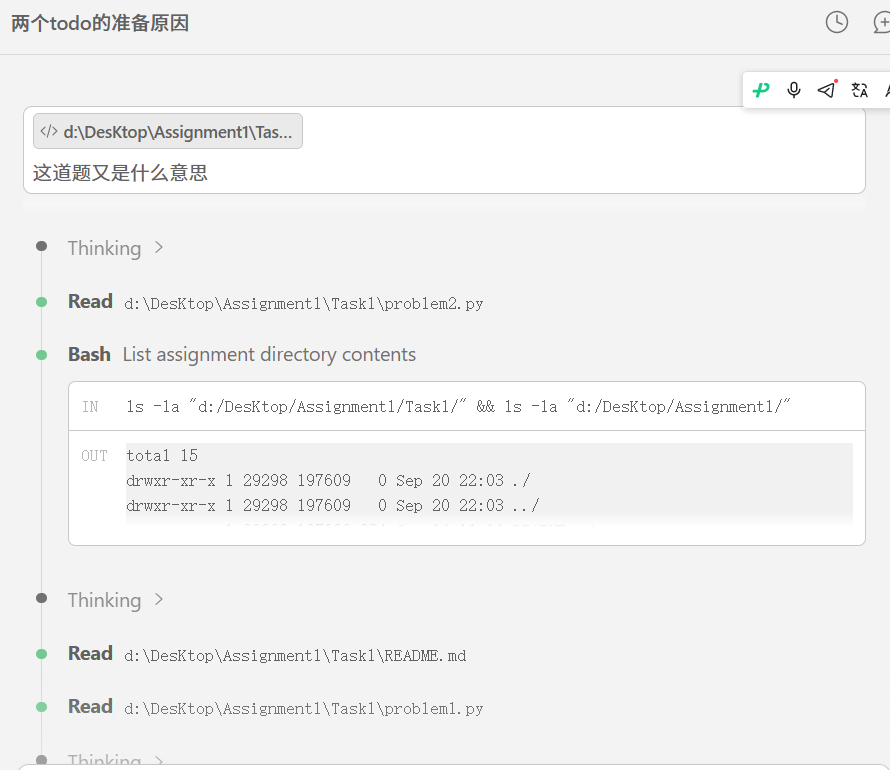
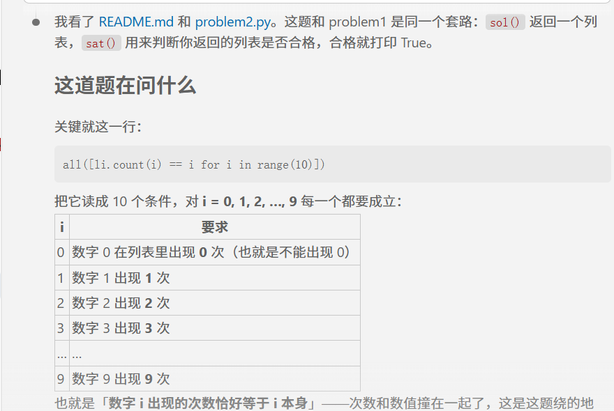
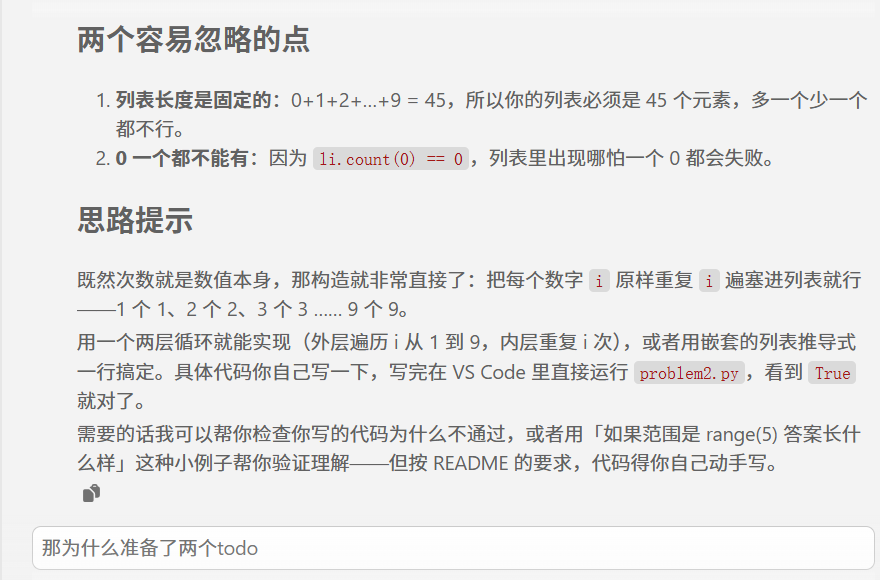
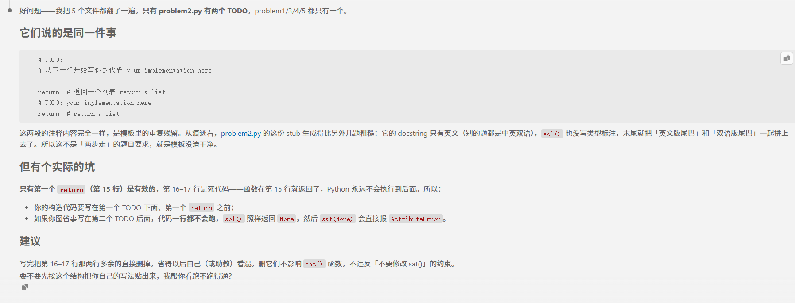

# Problem 1

## 用提示词得到答案 Your prompt to generate solution
Ture
```plain
# 用的AI模型 your AI model here
deeoseek -v4 -flash
# 用的提示词 your prompt here
```
这道题在问什么
## AI模型最初生成答案 Initial AI-generated solution

```python
# AI模型生成答案 AI-generated solution here
```
result = []
    for i in range(1, 10):      # i = 1, 2, ..., 9  (0 出现 0 次，所以不放 0)
        result += [i] * i       # 数字 i 重复 i 次
    return result  # 返回一个列表 return a list

## （可选）你修改的答案 (optional) Your edited solution

注意：如果AI模型直接生成正确答案，可以跳过这一部分 \
Note: you may skip this section if AI-generated solution is correct.

AI模型生成答案中出现的错误： \
The errors found in the AI-generated solution:
1. to be filled here
2. 
3.

你修改的答案 \
Your edited solution:

```python
# your solution after debugging here
```

## 与AI交互过程的截屏 Screenshots of interaction with AI

把与AI交互过程的截屏粘贴在下面 \
Please capture the screenshot and paste it here.



