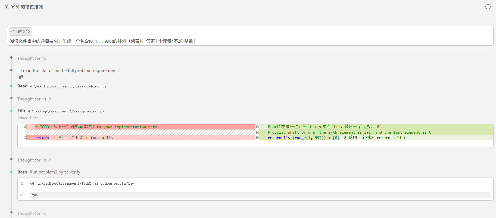
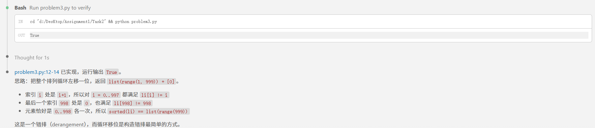

# Problem 1

## 用提示词得到答案 Your prompt to generate solution
True
```plain
# 用的AI模型 your AI model here
deepseek -v4 -flash[1m]
# 用的提示词 your prompt here
```
阅读文件当中的题目要求，生成一个包含[0, 1, ..., 998]的排列（列表），使第 i 个元素*不是*整数 i
## AI模型最初生成答案 Initial AI-generated solution
# 循环左移一位：第 i 个元素为 i+1，最后一个元素为 0
    # cyclic shift by one: the i-th element is i+1, and the last element is 0
    return list(range(1, 999)) + [0]  # 返回一个列表 return a list
```python
# AI模型生成答案 AI-generated solution here
```

## （可选）你修改的答案 (optional) Your edited solution

注意：如果AI模型直接生成正确答案，可以跳过这一部分 \
Note: you may skip this section if AI-generated solution is correct.

AI模型生成答案中出现的错误： \
The errors found in the AI-generated solution:
1. to be filled here
2. 
3.

你修改的答案 \
Your edited solution:

```python
# your solution after debugging here
```

## 与AI交互过程的截屏 Screenshots of interaction with AI

把与AI交互过程的截屏粘贴在下面 \
Please capture the screenshot and paste it here.

