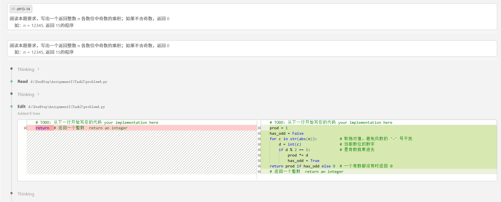
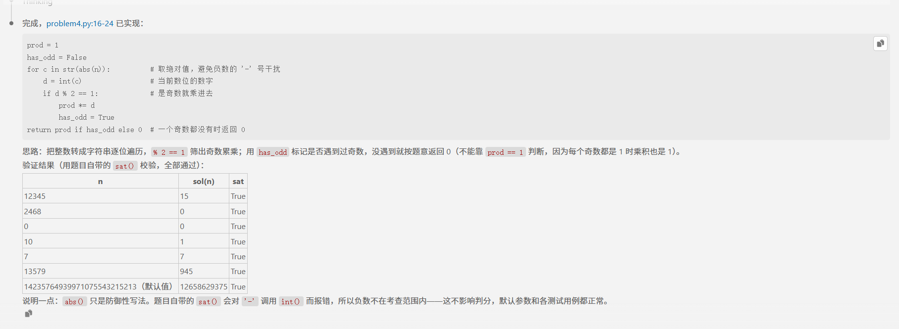

# Problem 1

## 用提示词得到答案 Your prompt to generate solution
True
```plain
# 用的AI模型 your AI model here
deepseek -v4 -flash[1m]
# 用的提示词 your prompt here
```
阅读本题要求，写出一个返回整数 n 各数位中奇数的乘积；如果不含奇数，返回 0
    如：n = 12345, 返回 15的程序
## AI模型最初生成答案 Initial AI-generated solution

```python
# AI模型生成答案 AI-generated solution here
```
   prod = 1
    has_odd = False
    for c in str(abs(n)):          # 取绝对值，避免负数的 '-' 号干扰
        d = int(c)                 # 当前数位的数字
        if d % 2 == 1:             # 是奇数就乘进去
            prod *= d
            has_odd = True
    return prod if has_odd else 0  # 一个奇数都没有时返回 0
    # 返回一个整数  return an integer
## （可选）你修改的答案 (optional) Your edited solution

注意：如果AI模型直接生成正确答案，可以跳过这一部分 \
Note: you may skip this section if AI-generated solution is correct.

AI模型生成答案中出现的错误： \
The errors found in the AI-generated solution:
1. to be filled here
2. 
3.

你修改的答案 \
Your edited solution:

```python
# your solution after debugging here
```

## 与AI交互过程的截屏 Screenshots of interaction with AI

把与AI交互过程的截屏粘贴在下面 \
Please capture the screenshot and paste it here.

