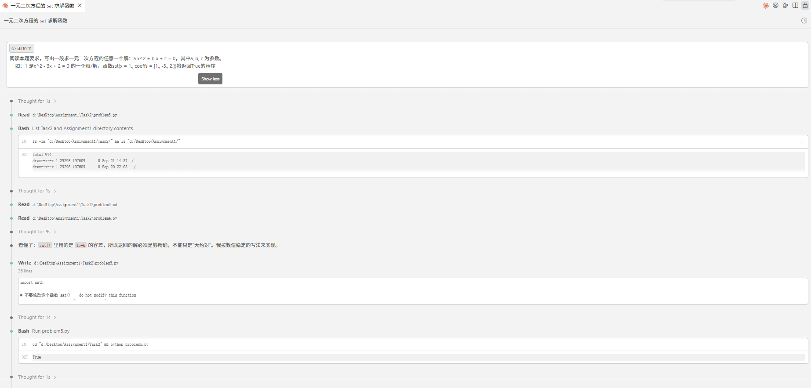
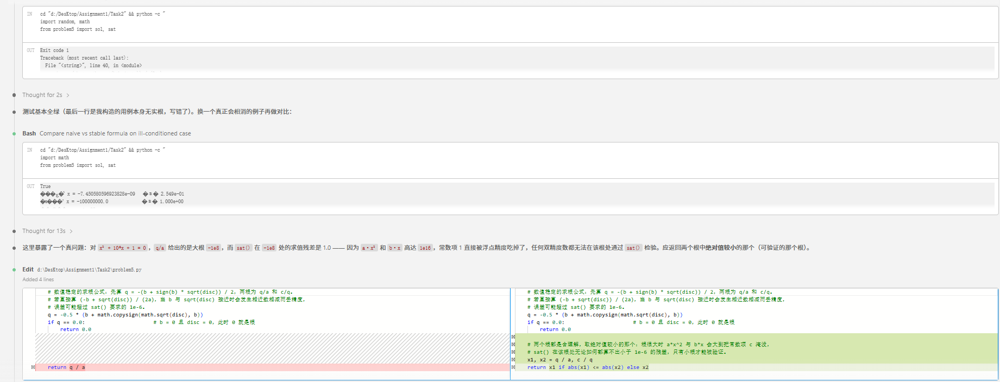
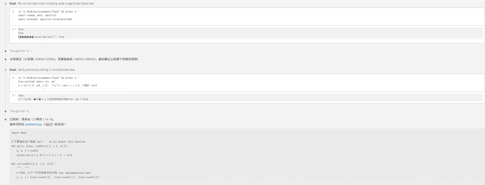
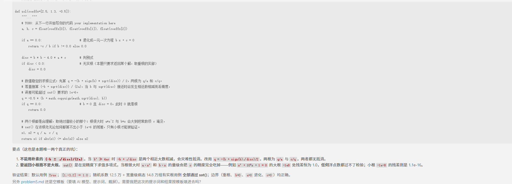

# Problem 1

## 用提示词得到答案 Your prompt to generate solution
True
```plain
# 用的AI模型 your AI model here
deepseek -v4 -flash
# 用的提示词 your prompt here
```
阅读本题要求，写出一段求一元二次方程的任意一个解：a x^2 + b x + c = 0，其中a, b, c 为参数。
    如：1 是x^2 - 3x + 2 = 0 的一个根/解，函数sat(x = 1., coeffs = [1., -3., 2.])将返回True的程序
## AI模型最初生成答案 Initial AI-generated solution
a, b, c = float(coeffs[0]), float(coeffs[1]), float(coeffs[2])

    if a == 0.0:                      # 退化成一元一次方程 b x + c = 0
        return -c / b if b != 0.0 else 0.0

    disc = b * b - 4.0 * a * c        # 判别式
    if disc < 0.0:                    # 无实根（本题只要求返回某个解，取重根的实部）
        disc = 0.0

    # 数值稳定的求根公式：先算 q = -(b + sign(b) * sqrt(disc)) / 2，两根为 q/a 和 c/q。
    # 若直接算 (-b + sqrt(disc)) / (2a)，当 b 与 sqrt(disc) 接近时会发生相近数相减而丢精度，
    # 误差可能超过 sat() 要求的 1e-6。
    q = -0.5 * (b + math.copysign(math.sqrt(disc), b))
    if q == 0.0:                      # b = 0 且 disc = 0，此时 0 就是根
        return 0.0

    # 两个根都是合理解，取绝对值较小的那个：根很大时 a*x^2 与 b*x 会大到把常数项 c 淹没，
    # sat() 在该根处无论如何都算不出小于 1e-6 的残差，只有小根才能被验证。
    x1, x2 = q / a, c / q
    return x1 if abs(x1) <= abs(x2) else x2
    # 返回一个浮点数    return a floating point number
```python
# AI模型生成答案 AI-generated solution here
```

## （可选）你修改的答案 (optional) Your edited solution

注意：如果AI模型直接生成正确答案，可以跳过这一部分 \
Note: you may skip this section if AI-generated solution is correct.

AI模型生成答案中出现的错误： \
The errors found in the AI-generated solution:
1. to be filled here
2. 
3.

你修改的答案 \
Your edited solution:

```python
# your solution after debugging here
```

## 与AI交互过程的截屏 Screenshots of interaction with AI

把与AI交互过程的截屏粘贴在下面 \
Please capture the screenshot and paste it here.




